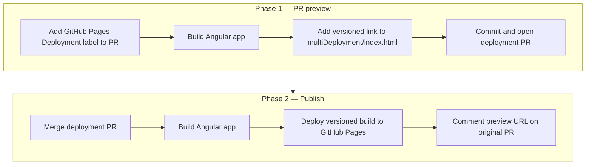

# Build and deployment pipeline

## Overview

`saffron-angular-example` uses GitHub Actions to build the Angular application and deploy it to GitHub Pages. There is one deployment pipeline with two phases:

1. **PR preview** — on-demand versioned preview for an open PR, used by QA and accessibility specialists to test changes before merging
2. **Publish** — deploys the versioned build to GitHub Pages after the deployment PR is merged

Two additional workflows keep Saffron packages up to date automatically.

> **Note:** Consumer-facing hosting [Plexus](https://github.com/tr/saffron_design_system/blob/main/docs/Deploying-to-tr-pct-plexus-preprod-on.md) is managed separately via Cumulus pipelines and is not part of the GitHub Actions workflows documented here.

## Diagram

**Workflows:** `multi-deployment-pr.yml` → `deploy.yml`

**Audience:** QA specialists, accessibility specialists reviewing a PR

**Trigger:** Manual — add `GitHub Pages Deployment` label to a PR

## Flow

1. **Label PR** — add the `GitHub Pages Deployment` label to the PR under review
2. **Build preview** — `multi-deployment-pr.yml` runs `npm install` and `npm run build`, appends a versioned entry to `multiDeployment/index.html`, commits, and opens a deployment PR
3. **Merge deployment PR** — team reviews and merges the deployment PR
4. **Deploy to GitHub Pages** — `deploy.yml` rebuilds the app and publishes `dist/saffron-angular-example` to GitHub Pages under the versioned path
5. **Comment on PR** — `deploy.yml` posts the preview URL back to the original PR

## Components

| Component                  | Role                                                                                                                              |
| -------------------------- | --------------------------------------------------------------------------------------------------------------------------------- |
| `multi-deployment-pr.yml`  | Triggered by `GitHub Pages Deployment` label — builds app, creates versioned link, opens deployment PR                            |
| `deploy.yml`               | Triggered on deployment PR merge — rebuilds app and deploys to GitHub Pages                                                       |
| `tag-contributors-prs.yml` | Auto-labels external contributor PRs with `contribution` when opened                                                              |
| `update-saffron.yml`       | Triggered by `repository_dispatch` — updates `@saffron/core-components` and `@saffron/core-styles` to latest alpha and opens a PR |
| `pre-alpha-build.yml`      | Triggered by `repository_dispatch` — same as above but for the pre-alpha channel, targeting the `a11y-improvements` branch        |
| GitHub Pages               | Hosts versioned PR preview deployments                                                                                            |

## Quality gates

| Gate            | Tool                              | Required                               |
| --------------- | --------------------------------- | -------------------------------------- |
| Angular build   | `npm run build`                   | Yes — deployment fails if build errors |
| Node.js version | `actions/setup-node@v3` (Node 22) | Yes                                    |

## Artifacts / Outputs

| Artifact                   | Location                        | Consumer                                 |
| -------------------------- | ------------------------------- | ---------------------------------------- |
| Built Angular app          | `dist/saffron-angular-example/` | GitHub Pages deployment                  |
| Versioned deployment index | `multiDeployment/index.html`    | Developers and QA navigating PR previews |
| GitHub Pages preview site  | Versioned path on GitHub Pages  | QA and accessibility specialists         |

## Dependencies

**Depends on:**

- `@saffron/core-components` and `@saffron/core-styles` installed from Thomson Reuters private npm registry
- GitHub Actions runners (`ubuntu-latest`)
- GitHub Pages (preview hosting)

**Depended on by:**

- QA and accessibility specialists validating PRs before merge

## Troubleshooting

| Symptom                         | Likely cause                             | Resolution                                                    |
| ------------------------------- | ---------------------------------------- | ------------------------------------------------------------- |
| Build fails on `npm install`    | Private registry credentials expired     | Rotate npm credentials and update GitHub secrets              |
| Preview not generated           | Label name doesn't match exactly         | Ensure label is `GitHub Pages Deployment` (case-sensitive)    |
| Deployment PR not created       | Build step failed                        | Check Actions tab on the triggering PR                        |
| Preview URL not commented on PR | Deploy job step failed                   | Check Actions tab for errors in the comment step              |
| Saffron update PR not created   | `repository_dispatch` event not received | Manually trigger `update-saffron.yml` via `workflow_dispatch` |